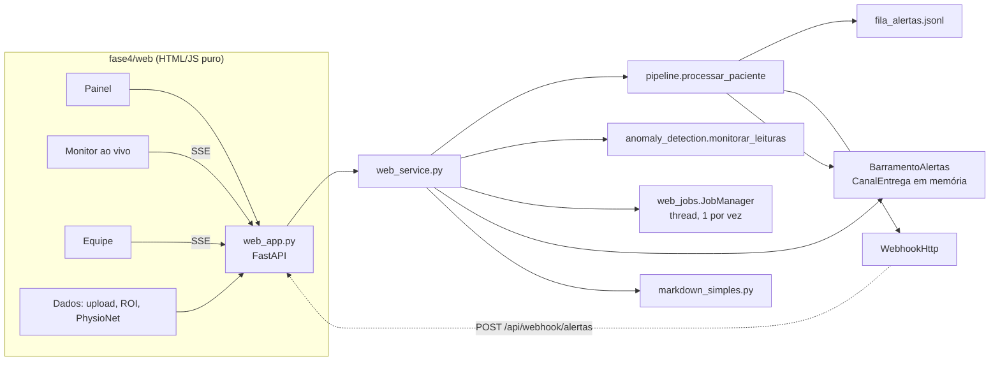

# Interface web da Fase 4 — arquitetura

Interface local para operar o pipeline de monitoramento multimodal pelo
navegador. Segue o padrão da Fase 3 (`fase3/web_app.py`): FastAPI servindo
uma página em HTML/JS/CSS puro, sem build e sem dependência nova; a lógica
clínica continua no pacote `fase4`, e o navegador só renderiza o que a API
devolve.

```powershell
python -m fase4.web_app                      # http://127.0.0.1:8020
python -m fase4.web_app --port 8021 --no-open-browser
```

## Visão geral



## Componentes

| Arquivo | Responsabilidade |
| --- | --- |
| `fase4/web_app.py` | rotas, modelos Pydantic, cabeçalhos de segurança (CSP, `nosniff`, `X-Frame-Options`), `main()` |
| `fase4/web_service.py` | `Deps` (pastas e funções injetáveis), `RepositorioPacientes` (quatro origens, validação de id e de caminho), `BarramentoAlertas`, serialização do resultado, `executar_processamento`, validação de uploads e de ROI, produtor SSE em thread, quadros JPEG e transcodificação H.264 opcional |
| `fase4/web_jobs.py` | `JobManager`: uma thread por vez, estados `aguardando/executando/cancelando/concluido/falhou/cancelado`, progresso, logs, cancelamento cooperativo |
| `fase4/markdown_simples.py` | converte os relatórios `.md` do pipeline em HTML (escapa antes de converter) |
| `fase4/web/index.html`, `app.js`, `api.js`, `render.js`, `grafico.js`, `roi.js`, `styles.css` | página; roteador por hash (`#/painel/PAC-0006`, `#/monitor/…`, `#/equipe`, `#/dados`); gráfico de 6 canais em `<canvas>`; marcação de ROI |
| `tests/test_fase4_web.py` | 22 testes com `TestClient`, sem rede |

## Origens de pacientes

| Origem | Dados | Resultados |
| --- | --- | --- |
| `sinteticos` | `fase4/data/amostras/<id>/` | `resultados/fase4/<id>/` |
| `enviados` | `fase4/data/enviados/<id>/` (upload pela interface) | `resultados/fase4/enviados/<id>/` |
| `ucf101` | `fase4/data/ucf101/<clipe>/` | `resultados/fase4/ucf101/<clipe>/` |
| `physionet` | `fase4/data/physionet/<registro>/` | `resultados/fase4/physionet/<registro>/` |

`localizar_amostras(id, raiz=...)` serve às três sem mudança. Ids obedecem
`^[A-Za-z0-9][A-Za-z0-9_-]{1,39}$` e a pasta resolvida precisa estar sob a
raiz da origem; nomes de arquivo (mídia, relatório, upload) vêm de allowlists.

## Endpoints

| Método | Rota | Função |
| --- | --- | --- |
| GET | `/api/status` | serviços Azure, backends instalados, faixas dos sinais, job ativo |
| GET | `/api/pacientes`, `/api/pacientes/{id}` | listagem e detalhe (arquivos, áudios, relatórios, vídeo) |
| POST | `/api/pacientes/{id}/processar` | síncrono (backends anotados, provedor ≠ `local`) ou **job** (202) |
| GET | `/api/pacientes/{id}/resultado` | `resultado_web.json` da última execução |
| GET | `/api/pacientes/{id}/relatorios/{nome}` | relatório em HTML e Markdown |
| GET | `/api/pacientes/{id}/midia/{nome}` | WAV/MP4 com `Range` |
| GET | `/api/pacientes/{id}/video/info`, `/quadro.jpg?t=` | metadados (codec, reprodutível no navegador) e quadro JPEG |
| GET | `/api/pacientes/{id}/tempo-real` | SSE: `inicio`, uma `leitura` por minuto, `fim` |
| GET | `/api/alertas`, `/api/alertas/stream` | histórico e SSE dos alertas entregues (`Last-Event-ID`) |
| POST | `/api/webhook/alertas` | receptor de webhook (só loopback) |
| GET/POST | `/api/jobs/atual`, `/api/jobs/cancelar` | job em andamento |
| POST/PUT/DELETE | `/api/pacientes/enviados…` | criar paciente, enviar arquivo por `PUT` cru, excluir |
| POST | `/api/physionet/baixar` | job: download + conversão + processamento |

## Decisões

- **Sem dependência nova.** Upload por `PUT` de corpo cru (progresso via XHR,
  limite por tipo, validação por conteúdo) em vez de multipart; conversor
  Markdown próprio para o subconjunto dos relatórios.
- **Entrega dos alertas.** O `BarramentoAlertas` é um `CanalEntrega` acrescentado
  **por último** à lista `canais_padrao(...)`; como o motor marca o canal antes de
  entregar, o registro em memória traz `canais_entrega` completo
  (`fila_jsonl`, `webhook`, `painel_web`). A aba Equipe é também o receptor de
  webhook: a própria CLI entrega nela com `FASE4_WEBHOOK_URL`.
- **Tempo real.** `monitorar_leituras` rende **toda** leitura (não só as com
  achado) para o gráfico andar; o produtor roda em thread e publica numa
  `asyncio.Queue` via `call_soon_threadsafe`. Sem `GZipMiddleware`;
  `Cache-Control: no-cache, no-transform`.
- **Vídeo.** Os MP4 do OpenCV são FMP4 (MPEG-4 Part 2), que o navegador não
  decodifica. A interface usa um *scrubber* de quadros JPEG servidos pelo
  servidor; se `ffmpeg` existir no PATH, gera `fisioterapia_anotado.h264.mp4`
  sob demanda e o `<video>` passa a reproduzir.
- **Jobs.** MediaPipe, YOLOv8, whisper local e registros PhysioNet rodam em
  job com polling de 1 s; a execução síncrona é serializada por um `Lock` e
  recusada com 409 enquanto há job.
- **Segurança (app local).** Bind `127.0.0.1`; CSP `default-src 'self'` sem
  estilos/handlers inline; upload, exclusão e webhook só de loopback
  (`--permitir-remoto` desliga); sem autenticação — não expor na rede.

## Contrato do resultado (`resultado_web.json`)

`ResultadoPaciente.to_dict()` (`paciente_id`, `modalidades_*`, `fusao`,
`achados`, `alertas`, `servicos_azure`, `arquivos_gerados`) mais `video`
(`ResultadoVideo.to_dict()` sem achados: `quadros_com_pose`,
`origem_area_critica`, `regra_mao`…), `audio` (atributos acústicos,
transcrição por segmento, análise de texto, `wer_referencia`), `origem`,
`opcoes`, `executado_em`, `relatorios` e `midias` (URLs do áudio e dos vídeos).

## UCF101 e qualidade da detecção

Os clipes são preparados por `fase4.data.baixar_ucf101`, com revisão e hash
fixados no manifesto. O seletor sugere MediaPipe/YOLOv8 para essa origem e
anotações para os pacientes sintéticos. Todos os seletores permanecem
disponíveis. `fonte.json` identifica o dataset e ativa o contexto
exploratório no pipeline, sem aplicar limites clínicos aos exercícios.

O objeto `video` inclui `contexto` e `avisos`. Medidas ausentes são `null`;
o relatório exibe “Não avaliado”. A contagem de pessoas pelo detector
genérico produz apenas observações e não alimenta alertas ou o risco.
## Estado da validação em 3 de novembro de 2026

Reprocessamos PAC-0006 e PAC-0002 pela rota de processamento usada pelo
front, com `provedor_azure=azure`, `arquivo_audio=consulta_fala.wav` e
backends de vídeo anotados. Speech e Language foram utilizados de fato,
com seis alertas no primeiro cenário e nenhum no segundo. Os resultados
persistidos em `resultado_web.json` alimentam a consulta posterior da interface.

O processamento de vídeo e áudio continua em lote; o monitor de sinais
vitais reproduz dados gravados de forma incremental. A interface não está
integrada a equipamentos hospitalares ou prontuários em produção.

Os relatórios de áudio explicitam a exclusão das regras vocais clínicas
quando a origem declarada é `tts_*`. Os filtros textuais consideram negação,
presença da expressão e termos positivos, mas não corrigem erros semânticos
introduzidos pelo reconhecimento de fala. A evidência detalhada encontra-se
em `resultados/fase4/azure_real/`.
